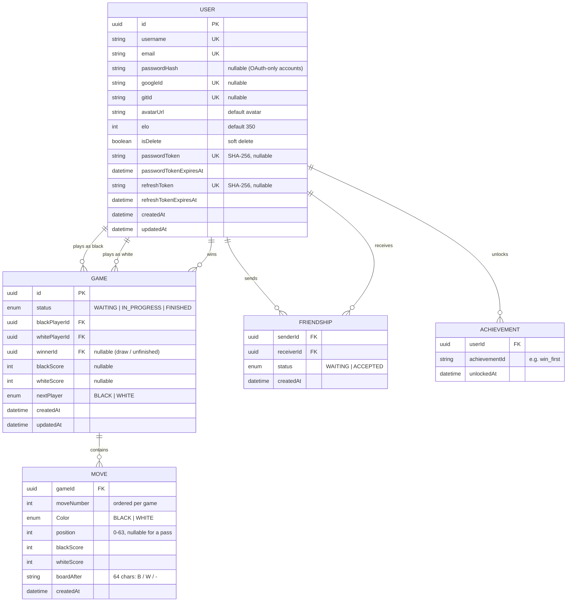

*This project has been created as part of the 42 curriculum by `bchallat`, `maguerin`, `pbret`, `tjacquel`.*


# 42 Othello

> A real-time, multiplayer **Othello (Reversi)** web platform: play locally, against an AI, or online against other players, climb the Elo leaderboard, unlock achievements and watch live games.

---

## Table of contents

1. [Description](#description)
2. [Instructions](#instructions)
3. [Team Information](#team-information)
4. [Project Management](#project-management)
5. [Technical Stack](#technical-stack)
6. [Architecture](#architecture)
7. [Database Schema](#database-schema)
8. [Features List](#features-list)
9. [Modules](#modules)
10. [Individual Contributions](#individual-contributions)
11. [Security](#security)
12. [Known Limitations](#known-limitations)
13. [Resources](#resources)

---

## Description

**42 Othello** is a full-stack web application built for the *ft_transcendence* project. Its goal is to offer a complete Othello experience: clear rules, smooth real-time play, a competitive ranking system and a basic social layer around the game.

Othello is a two-player strategy game on an 8×8 board. Players place black or white discs; every time a disc is placed so that a line of opponent discs is trapped between it and another disc of the same color, those discs flip. The game ends when neither player can move, and the player with the most discs wins.

### Key features

- **Four game modes**: Pass & Play (local, 2 players on one screen), VS AI, Online matchmaking (1v1 on separate computers) and **Bot vs Bot** streaming.
- **Server-authoritative game engine**: all moves are validated on the backend (NestJS), never trusted from the client.
- **Real-time** gameplay, matchmaking, chat and presence through WebSockets (Socket.IO).
- **Elo rating system**, global **leaderboard** with podium and personal rank.
- **20 achievements** persisted in the database.
- **Spectator mode**: watch live and recently finished games in real time.
- **User accounts**: email/password, Google and GitHub OAuth 2.0, password reset by email, profile with editable username and avatar upload.
- **Friends system** with live online/offline status.
- **Match history and statistics** on each profile.
- **Monitoring** with Prometheus and Grafana (including alerting to Discord).
- Fully **containerized**: the whole stack starts with a single command, served over **HTTPS**.

---

## Instructions

### Prerequisites

| Tool | Version / Notes |
|------|-----------------|
| Docker (or Podman) | 24+ recommended |
| Docker Compose plugin | v2+ |
| Make | Required for the automated build and certificate generation commands |
| OpenSSL | To generate a local self-signed certificate |
| Google Chrome | Latest stable (officially supported browser) |

No local Node.js installation is required to run the project; everything runs in containers. Node.js 20+ is only needed if you want to run the backend or frontend outside Docker.

### 1. Clone the repository

```bash
git clone # ADD VOGSPHERE address
cd 42_ft_transcendence
```

### 2. Configure the environment

Secrets are stored in a local `.env` file at the repository root. It is **ignored by Git**; a template is provided in `.env.example`.

```bash
cp .env.example .env
```

Then edit `.env`. The variables used by the project are:

| Variable | Description |
|----------|-------------|
| `POSTGRES_USER`, `POSTGRES_PASSWORD`, `POSTGRES_DB` | PostgreSQL credentials (the backend `DATABASE_URL` is built from them by `docker-compose.yml`) |
| `APP_URL` | Public URL of the app, e.g. `https://localhost:8443` (used in emails, OAuth redirects, Grafana root URL) |
| `PORT` | Backend internal port (default `3000`) |
| `JWT_SECRET` | Secret used to sign access tokens (HS256) |
| `JWT_EXPIRATION` | Access token lifetime, in seconds |
| `REFRESH_TOKEN_EXPIRATION` | Refresh token lifetime, in seconds |
| `PASSWORD_TOKEN_EXPIRATION` | Password reset token lifetime, in seconds |
| `GOOGLE_CLIENT_ID`, `GOOGLE_CLIENT_SECRET`, `GOOGLE_CALLBACK_URL` | Google OAuth 2.0 credentials |
| `GITHUB_CLIENT_ID`, `GITHUB_CLIENT_SECRET`, `GITHUB_CALLBACK_URL` | GitHub OAuth credentials |
| `MAIL_HOST`, `MAIL_PORT`, `MAIL_USER`, `MAIL_PASS`, `MAIL_FROM` | SMTP server used to send password reset emails |
| `GRAFANA_ADMIN_USER`, `GRAFANA_ADMIN_PASSWORD` | Grafana admin account |
| `GRAFANA_SECRET_KEY`, `GRAFANA_ENCRYPTION_KEY` | Grafana session key and secrets-manager encryption key |
| `DISCORD_WEBHOOK_URL` | Webhook used by Grafana alerts |

> OAuth callback URLs must match the ones declared in your Google / GitHub developer consoles, e.g. `https://localhost:8443/api/auth/google/callback` and `https://localhost:8443/api/auth/github/callback`.

### 3. Provide a TLS certificate

All browser-to-server traffic goes through the Nginx reverse proxy over HTTPS. For local development, a self-signed certificate is required.

This certificate is generated **automatically** when you start the project using `make`. If you prefer to generate it manually before running Docker Compose directly, you can execute the provided script:

```bash
bash ./proxy/generate-ssl.sh
```

**Your browser will warn about the self-signed certificate; accept it to continue.**


### 4. Build and run (single command)

To run the environment checks, generate the SSL certificates, and start the containers in one step, simply run:

```bash
make
```

If your environment is already set up and certificates are generated, the standard Docker Compose command will still work:

```bash
docker compose up --build
```

### 5. Access

| Service | URL |
|---------|-----|
| Application | https://localhost:8443 |
| Force redirection to HTTPS | http://localhost:8080 |
| Grafana | https://localhost:8443/grafana/ |


### Useful commands

```bash
docker ps -a                   # list all containers (running and stopped)
docker compose down            # stop the stack
docker compose down -v         # stop and delete volumes (database, Grafana, Prometheus data)
docker compose logs -f backend # follow backend logs
```

Makefile shortcuts:
```bash
make logs                      # follow logs for all containers
make shell-db                  # open a PostgreSQL prompt in the database
```

### Running the backend unit tests

```bash
cd backend
npm install
npm run test
```

---

## Team Information

<!-- TODO: fill in with the real team. Subject: 4 people → some members have several roles; 5 people → more specialised roles. -->

| Login | Role(s) | Responsibilities |
|-------|---------|------------------|
| `<login1>` | Product Owner + Developer | Defines the vision and priorities of the product, validates features, maintains the backlog, develops `<…>`. |
| `<login2>` | Project Manager + Developer | Organizes meetings, tracks progress and blockers, ensures team communication, develops `<…>`. |
| `<login3>` | Technical Lead + Developer | Defines the architecture and technology stack, reviews critical code, ensures code quality, develops `<…>`. |
| `<login4>` | Developer | Implements features and modules, writes tests, documents their work (`<…>`). |

---

## Project Management

<!-- TODO: adapt to what your team really did. Be honest: this is discussed during evaluation. -->

- **Task organization**: work was split into small features/modules (auth, game engine, matchmaking, profile, friends, leaderboard, achievements, spectator, monitoring…) tracked as **GitHub Issues**, `<and/or a GitHub Project board / Trello>`.
- **Meetings**: `<weekly / bi-weekly>` sync to review progress, unblock each other and plan the next iteration.
- **Git workflow**: feature branches, pull requests and code review by at least one other member for important changes; meaningful commit messages.
- **Communication**: `<Discord / Slack>` for day-to-day communication.
- **Documentation**: key decisions and architecture notes are kept in the repository (this README and code comments).

---

## Technical Stack

### Frontend

| Technology | Usage |
|------------|-------|
| **React** + **TypeScript** | UI framework |
| **Vite** | Dev server / bundler |
| **React Router** | Client-side routing (lazy-loaded pages, protected and guest routes) |
| **TanStack Query (React Query)** | Server-state management and caching (auth session, profile, friends, achievements, leaderboard) |
| **Socket.IO client** | Real-time communication with the backend |
| **Tailwind CSS v4** + **DaisyUI** | Styling and component primitives, with a custom `Othello` theme |

### Backend

| Technology | Usage |
|------------|-------|
| **NestJS** + **TypeScript** | Backend framework (modular architecture, dependency injection, guards, pipes, interceptors) |
| **Socket.IO** (`@nestjs/websockets`) | WebSocket gateways (game, chat, presence, spectator) |
| **Passport** (`passport-jwt`, Google OAuth 2.0, GitHub) | Authentication strategies |
| **argon2** | Password hashing |
| **class-validator** / `ValidationPipe` | Request validation (DTOs) |
| **Multer** | Avatar upload (PNG/JPEG, max 2 MB) |
| **Nodemailer** | Password reset emails |
| **Jest** | Unit tests (game engine, board, services) |

### Database

- **PostgreSQL 16** accessed through the **Prisma ORM**.
- *Why PostgreSQL?* The data is highly relational (users ↔ games ↔ moves ↔ friendships ↔ achievements), requires integrity constraints, unique indexes and **transactions** (a finished game must atomically save the last move, close the game and update both players' Elo). A relational database fits this need far better than a document store.
- *Why Prisma?* Type-safe queries shared with the TypeScript code, declarative schema and migrations, and clean transaction support.

### Infrastructure & DevOps

| Technology | Usage |
|------------|-------|
| **Docker Compose** | Orchestration of the whole stack with one command |
| **Nginx** | Reverse proxy, HTTPS termination, routing of `/api`, WebSockets and `/grafana` |
| **Prometheus** + **Grafana** | Metrics collection, dashboards and alerting |
| `@willsoto/nestjs-prometheus` | Backend metrics exposed on `/metrics` |
| `postgres-exporter`, `node-exporter`, `nginx-prometheus-exporter` | Database, host and proxy metrics |

### Justification of the major technical choices

- **NestJS**: its modules, DI container, guards and gateways give a structured architecture well suited to a project with many features (REST + WebSockets) developed by several people in parallel.
- **React + React Query**: component-based UI and a declarative cache/invalidation model that keeps friend lists, profiles and leaderboards consistent without manual state plumbing.
- **Server-authoritative engine**: the Othello rules live in a pure, unit-tested `OthelloEngine` class on the backend, shared by every mode (local, bot, online). The client only displays state and sends intended moves.
- **Socket.IO**: automatic reconnection, rooms (one per game / waiting room / user) and a simple event API, ideal for matchmaking, live games and presence.
- **JWT in httpOnly cookies + hashed refresh tokens**: protects tokens from XSS and allows silent session renewal.

---

## Architecture

```
                      ┌──────────────────────────────────────────────┐
   Browser ──HTTPS──► │  Nginx reverse proxy (8443)                  │
                      └───────┬───────────────┬──────────────┬───────┘
                              │               │              │
                    /  (SPA)  │      /api, WS │     /grafana │
                              ▼               ▼              ▼
                       ┌───────────┐   ┌────────────┐   ┌──────────┐
                       │ Frontend  │   │  Backend   │   │ Grafana  │
                       │ React/Vite│   │  NestJS    │   └────┬─────┘
                       └───────────┘   └─────┬──────┘        │
                                             │          ┌────▼─────┐
                                       Prisma│          │Prometheus│◄── exporters
                                             ▼          └──────────┘   (node, nginx, postgres)
                                       ┌────────────┐
                                       │ PostgreSQL │
                                       └────────────┘
```

### Backend modules (NestJS)

| Module | Responsibility |
|--------|----------------|
| `auth` | Registration, login, logout, OAuth (Google/GitHub), JWT + refresh tokens, password reset |
| `user` | Profile, avatar upload, match history, rank, soft deletion |
| `othello` | Game engine (`OthelloEngine`, `OthelloBoard`), game service (local / bot / online / bot-vs-bot) and WebSocket gateway |
| `game-room` | Matchmaking queue (waiting rooms, color preference) |
| `compute-player` | AI opponent strategies (Minimax with alpha-beta pruning, random) |
| `elo` | Elo computation and application inside DB transactions |
| `achievement` | Achievement evaluation at the end of each finished game |
| `leaderboard` | Global ranking |
| `friend` | Friend requests, acceptance, removal, search |
| `presence` | Online/offline status of friends (dedicated `/presence` WebSocket namespace) |
| `spectator` | Live games feed (dedicated `/spectator` namespace) |
| `chat` | Chat rooms over WebSocket |
| `mail` | SMTP email sending |
| `monitoring` / `health` | Prometheus metrics and health check |

---

## Database Schema

<!-- TODO: double-check this section against backend/prisma/schema.prisma (enum values, defaults, composite keys). -->



### Tables and relations

- **User**: account data. Authentication methods are independent (`passwordHash`, `googleId`, `gitId`), so a local account can later be linked to Google/GitHub by email. Deleted accounts are *soft-deleted* (`isDelete`) and anonymized so that game history stays consistent. Password reset and refresh tokens are stored **hashed**.
- **Game**: one Othello match between two users (black / white), with its status, final scores and winner.
- **Move**: one row per move, ordered by `moveNumber`. `boardAfter` stores the whole board as a 64-character string (`B`, `W`, `-`), which allows the spectator feed and the achievement engine to rebuild any position without replaying the game.
- **Friendship**: a directed request (`sender` → `receiver`) with a `WAITING` / `ACCEPTED` status; a unique constraint prevents duplicate requests.
- **Achievement**: unlocked achievements per user (unique per `(userId, achievementId)`); the achievements themselves are defined in code.

---

## Features List

<!-- TODO: replace <login> with the real contributors of each feature. -->

| Feature | Description | Team member(s) |
|---------|-------------|----------------|
| **Othello engine** | Pure `OthelloEngine`/`OthelloBoard` classes: legal-move computation (8 directions), disc flipping, automatic turn passing, game-over detection and scoring. Covered by unit tests. | `<login>` |
| **Local game (Pass & Play)** | Two players share one screen; the server validates every move. | `<login>` |
| **VS AI** | Play against the bot as Black or White, with legal-move hints. | `<login>` |
| **Bot vs Bot stream** | Watch two AIs play each other live. | `<login>` |
| **Online matchmaking** | Matchmaking queue with optional color preference; two players on different machines are paired into a live game. Reconnection to a game after a page refresh. | `<login>` |
| **Forfeit** | A player can give up; the opponent wins and Elo is updated. | `<login>` |
| **Elo & ranking** | Elo updated atomically at the end of each online game (K = 40 for the first 30 games, then 20; floor at 187; default 350). | `<login>` |
| **Leaderboard** | Podium (top 3), top-25 table, and the current user's rank if outside the top. | `<login>` |
| **Achievements** | 20 achievements (corners, flips, passes, win margins, comebacks, streaks, Elo thresholds, rivalries…) evaluated at the end of each finished online game and shown on a dedicated page and on the profile. | `<login>` |
| **Spectator mode** | List of live and recently finished games with mini-boards, scores, timers; dedicated page to follow one game in real time. | `<login>` |
| **Registration / login** | Email + password (argon2), input validation on both frontend and backend. | `<login>` |
| **OAuth 2.0** | Google and GitHub sign-in with automatic account linking by email. | `<login>` |
| **Session management** | JWT access token + rotating-friendly refresh token in `httpOnly`, `secure` cookies; silent renewal. | `<login>` |
| **Password reset** | Reset link sent by email (token hashed in DB, limited lifetime). | `<login>` |
| **Profile** | Public profile page (Elo, rank, stats, recent matches, achievements); the owner can edit username and upload an avatar (default avatar provided). | `<login>` |
| **Friends** | Search users, send/accept/refuse/cancel requests, remove friends, see their online status in real time. | `<login>` |
| **Chat** | Real-time chat rooms over WebSockets (global chat and in online games). | `<login>` |
| **Monitoring** | Prometheus + Grafana dashboards, exporters (Node, Nginx, PostgreSQL), Discord alerting. | `<login>` |
| **Legal pages** | Privacy Policy and Terms of Service, linked from the footer. | `<login>` |
| **Rules & About pages** | Illustrated Othello rules, home page, about page. | `<login>` |

---

## Modules

Target: **14 points** minimum. Major = 2 pts, Minor = 1 pt.

| # | Category | Module | Type | Points |
|---|----------|--------|------|--------|
| 1 | Web | Use a framework for both frontend and backend (React + NestJS) | Major | 2 |
| 2 | Web | Real-time features using WebSockets | Major | 2 |
| 3 | Web | Allow users to interact with other users (chat, profile, friends) | Major | 2 |
| 4 | Web | Use an ORM for the database (Prisma) | Minor | 1 |
| 5 | User Management | Standard user management and authentication | Major | 2 |
| 6 | User Management | Game statistics and match history | Minor | 1 |
| 7 | User Management | Remote authentication with OAuth 2.0 (Google, GitHub) | Minor | 1 |
| 8 | Artificial Intelligence | AI opponent for the game | Major | 2 |
| 9 | Gaming & UX | Complete web-based game (Othello) | Major | 2 |
| 10 | Gaming & UX | Remote players | Major | 2 |
| 11 | Gaming & UX | Spectator mode | Minor | 1 |
| 12 | Gaming & UX | Gamification system (achievements, leaderboard, Elo rank/progression) | Minor | 1 |
| 13 | DevOps | Monitoring system with Prometheus and Grafana | Major | 2 |
| | | **Total** | | **21** |

> The total exceeds 14 on purpose: the subject states that only fully functional modules are counted, so the extra points act as a safety margin (and potential bonus).

### Justification and implementation of each module

#### 1. Framework for frontend and backend (Major)
**Why:** structured, maintainable code for a feature-rich project developed by several people.
**How:** React + TypeScript + Vite on the frontend; NestJS on the backend with a modular architecture (one module per domain), DTO validation, guards, interceptors and exception filters. — *Team: `<logins>`*

#### 2. Real-time features with WebSockets (Major)
**Why:** an online board game needs instant, bidirectional updates.
**How:** Socket.IO gateways for the game (`createBotGame`, `joinOnlineQueue`, `onlinePlayMove`, `gameState`, `matchFound`…), chat, presence and the spectator feed. Events are broadcast to Socket.IO *rooms* (one per game / waiting room / user) so only concerned clients are notified. Connection and disconnection are handled gracefully (waiting rooms are cleaned on disconnect, presence is tracked per socket so multi-tab users stay "online" until their last socket closes). — *Team: `<logins>`*

#### 3. User interaction: chat, profile, friends (Major)
**Why:** a social layer keeps players engaged.
**How:** chat rooms with history, public profile pages, and a complete friends system (search, request, accept, refuse, cancel, remove) with automatic acceptance when two users invite each other. — *Team: `<logins>`*

#### 4. ORM (Minor)
**Why:** type safety and safe migrations.
**How:** Prisma (`PrismaService` shared globally), interactive transactions for game completion + Elo update. — *Team: `<logins>`*

#### 5. Standard user management and authentication (Major)
**Why:** mandatory foundation of the social features.
**How:** profile update (username), avatar upload with default avatar (PNG/JPEG, 2 MB limit, old file deleted on replacement), friends with live online status, profile page, secure sessions and password reset. — *Team: `<logins>`*

#### 6. Game statistics and match history (Minor)
**How:** each profile displays wins, losses, draws, win rate, average discs, Elo, rank, and the recent match list (opponent, date, result, score); leaderboard integration. — *Team: `<logins>`*

#### 7. OAuth 2.0 (Minor)
**How:** Passport strategies for Google and GitHub; users are looked up by provider id, then by email (existing accounts are linked), otherwise created. Failures redirect to `/connect?error=oauth_failed`. — *Team: `<logins>`*

#### 8. AI opponent (Major)
**Why:** lets a player train and play at any time without waiting for an opponent.
**How:** `ComputePlayerService` chooses between two strategies:
- **Minimax with alpha-beta pruning** (`MinmaxBotStrategy`): evaluates positions with a *positional weight matrix* (corners highly valued, "X/C-squares" next to corners penalized) plus a *mobility* term (number of moves available to each side); terminal positions are scored by final disc difference.
- **Random legal move** (`RandomBotStrategy`): used with a 20 % probability at each turn, so the AI is **not perfect** and can be beaten, simulating human-like mistakes.

The AI is built on the same engine as the human game (`OthelloEngine.clone()` / `fromState()`), and is also used for the Bot vs Bot stream. — *Team: `<logins>`*

#### 9. Complete web-based game (Major)
**How:** full Othello rules (flips in 8 directions, forced pass, end of game, winner/draw), highlighted legal moves, animated discs, score and turn display, end-of-game modal, rules page. Rules are enforced server-side. — *Team: `<logins>`*

#### 10. Remote players (Major)
**How:** matchmaking queue that pairs two users on different computers in real time, with optional color preference; the game state is pushed to both players after each move; a player who refreshes the page recovers the game from the server using the saved game id; disconnected players leave the waiting queue. — *Team: `<logins>`*

#### 11. Spectator mode (Minor)
**How:** dedicated `/spectator` namespace; `/watch` lists live and recently finished (< 10 min) games, sorted by status, human vs bot and Elo; `/watch/:gameId` follows one game live. The server re-broadcasts the live games list after every move. — *Team: `<logins>`*

#### 12. Gamification (Minor)
**How:** persistent (database-backed) **achievements** (20, with progress bar and unlock dates), **leaderboard** (podium + table), and an **Elo rating / rank** progression system with clear rules (see *Features list*). Visual feedback on the achievements page and profile. — *Team: `<logins>`*

#### 13. Monitoring with Prometheus and Grafana (Major)
**How:** the backend exposes `/metrics` (default Node.js metrics); Prometheus scrapes the backend and the `node-exporter`, `nginx-prometheus-exporter` and `postgres-exporter` services; Grafana is provisioned from files (datasources, dashboards, alert rules), served under `/grafana/` behind the proxy, anonymous access disabled, secure cookies, and alerts sent to a Discord webhook. — *Team: `<logins>`*

---

## Individual Contributions

<!-- TODO: fill in honestly for each member: what they did, challenges and how they were solved. -->

### `<login1>`
- **Implemented:** `<features / modules / components>`
- **Challenges & solutions:** `<…>`

### `<login2>`
- **Implemented:** `<features / modules / components>`
- **Challenges & solutions:** `<…>`

### `<login3>`
- **Implemented:** `<features / modules / components>`
- **Challenges & solutions:** `<…>`

### `<login4>`
- **Implemented:** `<features / modules / components>`
- **Challenges & solutions:** `<…>`

---

## Security

- Passwords hashed with **argon2** (salted); strong password policy (8–255 chars, at least one letter, one digit and one special character) validated on the frontend **and** the backend.
- JWT access token and refresh token stored in **`httpOnly`, `secure`, `sameSite=lax`** cookies; refresh and reset tokens are stored **hashed (SHA-256)** in the database.
- Password reset flow does not reveal whether an email exists.
- All DTOs validated with `class-validator`; the global `ValidationPipe` strips unknown fields (`whitelist`).
- Uploaded avatars are filtered by MIME type and limited to 2 MB.
- All external traffic goes through **HTTPS** (Nginx); the database and internal services are not exposed publicly.
- Credentials live in a Git-ignored `.env`; `.env.example` is provided.
- Server-side game validation: moves are checked against the engine and the player's turn, so a client cannot cheat.

---

## Known Limitations

<!-- TODO: keep only what is true for the final version. -->

- The chat history is kept **in memory** (lost on backend restart); spectator chat is not implemented yet.
- Local, bot and bot-vs-bot games are kept in memory and are not persisted; only **online** games are saved in the database (and affect Elo, history and achievements).
- Officially supported browser: **latest stable Google Chrome**. Other browsers have not been fully tested.
- The legal pages were generated from templates and must be reviewed before any real-world deployment.

---

## Resources

### Documentation & references

- [Othello rules — World Othello Federation](https://www.worldothello.org/about/about-othello/othello-rules/official-rules/english)
- [Reversi / Othello — Wikipedia](https://en.wikipedia.org/wiki/Reversi)
- [Minimax](https://en.wikipedia.org/wiki/Minimax) and [Alpha–beta pruning](https://en.wikipedia.org/wiki/Alpha%E2%80%93beta_pruning)
- [Elo rating system](https://en.wikipedia.org/wiki/Elo_rating_system)
- [NestJS documentation](https://docs.nestjs.com/) (modules, guards, interceptors, gateways, Passport, testing)
- [React documentation](https://react.dev/) and [React Router](https://reactrouter.com/)
- [TanStack Query documentation](https://tanstack.com/query/latest)
- [Socket.IO documentation](https://socket.io/docs/v4/)
- [Prisma documentation](https://www.prisma.io/docs)
- [PostgreSQL documentation](https://www.postgresql.org/docs/16/)
- [Tailwind CSS](https://tailwindcss.com/docs) and [DaisyUI](https://daisyui.com/)
- [Passport.js](https://www.passportjs.org/) — Google OAuth 2.0 and GitHub strategies
- [Docker Compose](https://docs.docker.com/compose/), [Nginx](https://nginx.org/en/docs/)
- [Prometheus](https://prometheus.io/docs/) and [Grafana](https://grafana.com/docs/)
- [OWASP Cheat Sheet Series](https://cheatsheetseries.owasp.org/) (password storage, session management)

### Use of AI

<!-- TODO: adjust to what each member really did; the subject asks for the tasks and the parts of the project concerned. -->

AI assistants (`<e.g. Claude, ChatGPT, GitHub Copilot>`) were used as a support tool, never as a replacement for understanding the code. Every team member can explain the parts they submitted.

| Task | Part of the project |
|------|---------------------|
| Explaining concepts and library usage (NestJS DI, Passport strategies, Prisma transactions, React Query) | Backend & frontend learning |
| Reviewing and suggesting improvements to code written by the team | Game engine, services, hooks |
| Helping write and structure unit tests | `OthelloEngine`, `OthelloBoard`, services specs |
| Debugging assistance (layout issues, WebSocket event flow) | Board component, game sockets |
| Drafting documentation, legal-page templates and this README | Documentation |

All AI-generated suggestions were reviewed, tested and adapted by the team before being integrated.

---

## License

<!-- TODO: add a license if relevant, otherwise remove this section. -->

Educational project developed as part of the 42 curriculum.
