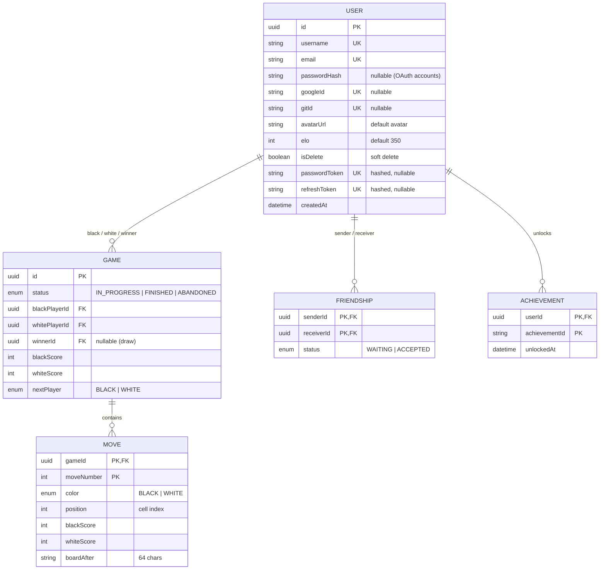

*This project has been created as part of the 42 curriculum by bchallat, maguerin, pbret, tjacquel.*

# 42 Othello

> A real-time multiplayer **Othello (Reversi)** web platform: play locally, against an AI or online, climb the Elo leaderboard, unlock achievements and watch live games.

## Table of contents

[Description](#description) · [Instructions](#instructions) · [Team](#team-information) · [Project management](#project-management) · [Technical stack](#technical-stack) · [Database schema](#database-schema) · [Features](#features-list) · [Modules](#modules) · [Contributions](#individual-contributions) · [Limitations](#known-limitations) · [Resources](#resources)

---

## Description

**42 Othello** is our *ft_transcendence* project: a full-stack web application (frontend, backend, database) built around the board game Othello. Two players place black and white discs on an 8×8 board; discs trapped between two discs of the opposite color are flipped, and the player with the most discs when nobody can move wins.

### Key features

- **4 game modes**: Pass & Play (local), VS AI, Online matchmaking (1v1 on two computers), Bot vs Bot stream.
- **Server-authoritative engine**: every move is validated by the backend, never trusted from the client.
- **Real time** (Socket.IO): matchmaking, live games, chat, online presence, spectator feed.
- **Accounts**: email/password, Google and GitHub OAuth, password reset by email, avatar upload.
- **Social**: friends with live online status, public profiles, chat.
- **Progression**: Elo rating, leaderboard, 20 achievements, match history and statistics.
- **Spectator mode**: watch live and recently finished games.
- **Monitoring**: Prometheus + Grafana with Discord alerting.
- **One command, HTTPS**: the whole stack runs in Docker behind an Nginx reverse proxy.

---

## Instructions

### Prerequisites

| Tool | Notes |
|------|-------|
| Docker + Docker Compose v2 | Everything runs in containers (no local Node.js needed) |
| Make | Entry point of the project (`make`) |
| OpenSSL | Generates the local self-signed TLS certificate |
| Google Chrome | Latest stable (supported browser) |

### Run the project

```bash
git clone git@github.com:HopHouse13/42_ft_transcendence.git
cd 42_ft_transcendence
cp .env.example .env     # then fill in every value (see below)
make                     # checks .env, generates the SSL certificate, builds and starts everything
```

Your browser will warn about the self-signed certificate: accept it to continue.

### Environment (`.env`)

The `.env` file is ignored by Git; `.env.example` is the template. `make` refuses to start if a variable is empty.

| Variable(s) | Purpose |
|-------------|---------|
| `POSTGRES_USER`, `POSTGRES_PASSWORD`, `POSTGRES_DB` | Database credentials (`DATABASE_URL` is built from them by `docker-compose.yml`) |
| `APP_URL`, `PORT` | Public URL (`https://localhost:8443`) and backend internal port |
| `JWT_SECRET` | Access-token signing secret (`openssl rand -base64 32`) |
| `JWT_EXPIRATION`, `REFRESH_TOKEN_EXPIRATION`, `PASSWORD_TOKEN_EXPIRATION` | Token lifetimes, in seconds |
| `GOOGLE_*`, `GITHUB_*` | OAuth client id / secret / callback URL (must match your developer consoles) |
| `MAIL_HOST`, `MAIL_PORT`, `MAIL_USER`, `MAIL_PASS`, `MAIL_FROM` | SMTP server for password reset emails |
| `GRAFANA_ADMIN_USER`, `GRAFANA_ADMIN_PASSWORD`, `GRAFANA_SECRET_KEY`, `GRAFANA_ENCRYPTION_KEY` | Grafana admin account and keys |
| `DISCORD_WEBHOOK_URL` | Grafana alert notifications |

#### Where to get the third-party values

| Service | Variables | Tutorial | Key points |
|---------|-----------|----------|------------|
| Google OAuth | `GOOGLE_CLIENT_ID`, `GOOGLE_CLIENT_SECRET`, `GOOGLE_CALLBACK_URL` | [Create an OAuth web client](https://support.google.com/cloud/answer/15549257) · [Consent screen & test users](https://support.google.com/cloud/answer/15549945) | Client type: **Web application**. Add `https://localhost:8443/api/auth/google/callback` as an authorized redirect URI. Copy the secret at creation: it is not shown in full afterwards. |
| GitHub OAuth | `GITHUB_CLIENT_ID`, `GITHUB_CLIENT_SECRET`, `GITHUB_CALLBACK_URL` | [Creating an OAuth app](https://docs.github.com/en/apps/oauth-apps/building-oauth-apps/creating-an-oauth-app) | Homepage URL: `https://localhost:8443`. Callback URL: `https://localhost:8443/api/auth/github/callback`. Click "Generate a new client secret". |
| Brevo (SMTP) | `MAIL_HOST`, `MAIL_PORT`, `MAIL_USER`, `MAIL_PASS`, `MAIL_FROM` | [Send emails with Brevo SMTP](https://help.brevo.com/hc/en-us/articles/7924908994450) · [SMTP integration](https://developers.brevo.com/docs/smtp-integration.md) | `MAIL_HOST=smtp-relay.brevo.com`, `MAIL_PORT=587`. `MAIL_USER` is the SMTP login shown in [SMTP & API](https://app.brevo.com/settings/keys/smtp), and `MAIL_PASS` is an **SMTP key**, not an API key. |
| Discord webhook | `DISCORD_WEBHOOK_URL` | [Intro to Webhooks](https://support.discord.com/hc/en-us/articles/228383668-Intro-to-Webhooks) | Server Settings → Integrations → Webhooks → Copy Webhook URL. Keep it private. |

> Callback URLs must match **exactly** what is declared in the Google / GitHub consoles (a mismatch gives `redirect_uri_mismatch`). Google changes can take a few minutes to apply.

### Access

| Service | URL |
|---------|-----|
| Application | https://localhost:8443 |
| HTTP (redirects to HTTPS) | http://localhost:8080 |
| Grafana | https://localhost:8443/grafana/ |

`/health` (Docker healthcheck) and `/api/metrics` (Prometheus scraping) are only reachable inside the Docker network; Nginx answers a JSON 404 for `/api/metrics` from outside.

### Useful commands

| Command | Effect |
|---------|--------|
| `make` / `make up` | Build and start the stack |
| `make down` | Stop the stack |
| `make fclean` | Remove containers, images **and volumes** (database wiped) |
| `make re` | `fclean` then `all` |
| `make logs` | Follow all logs |
| `make shell-back` / `shell-front` / `shell-proxy` / `shell-db` | Open a shell (or `psql`) in a container |
| `make seed-game` | Insert one finished game between the oldest and newest users |

Backend unit tests (Jest): `cd backend && npm install && npm run test`.

---

## Team Information

<!-- TODO: fill in roles. 4 members → some have several roles. -->

| Login | Role(s) | Responsibilities |
|-------|---------|------------------|
| `bchallat` | `<PO / PM / Tech Lead> + Developer` | `<…>` |
| `maguerin` | `<…> + Developer` | `<…>` |
| `pbret` | `<…> + Developer` | `<…>` |
| `tjacquel` | `<…> + Developer` | `<…>` |

---

## Project Management

<!-- TODO: keep only what is true. -->

- **Organization**: work split into small features (auth, engine, matchmaking, profile, friends, leaderboard, achievements, spectator, monitoring…), one Git branch per feature, merged into `main`.
- **Tracking**: `<GitHub Issues / Projects / Trello>`.
- **Meetings**: `<weekly / bi-weekly>` sync on progress and blockers.
- **Communication**: Discord (a GitHub Action posts every push to a Discord channel).
- **Code review**: important changes reviewed by another member before merge.

---

## Technical Stack

| Layer | Technologies |
|-------|--------------|
| **Frontend** | React + TypeScript, Vite, React Router, TanStack Query, Socket.IO client, Tailwind CSS v4 + DaisyUI |
| **Backend** | NestJS + TypeScript, Socket.IO gateways, Passport (JWT, Google, GitHub), argon2, class-validator, Multer, Nodemailer, Jest |
| **Database** | PostgreSQL 16 through the Prisma ORM |
| **Infra** | Docker Compose, Nginx (HTTPS reverse proxy), Prometheus, Grafana, node / nginx / postgres exporters |

### Why these choices

- **NestJS**: modules, dependency injection, guards and gateways give a clear structure for REST + WebSockets developed by several people in parallel.
- **React + TanStack Query**: component UI and a declarative cache that keeps profiles, friends and leaderboard consistent.
- **Socket.IO**: rooms, automatic reconnection and a simple event API for matchmaking, live games and presence.
- **PostgreSQL + Prisma**: the data is relational (users, games, moves, friendships, achievements) and needs constraints and transactions (a finished game atomically saves the result and updates both Elo). Prisma adds type-safe queries and versioned migrations.
- **Pure game engine**: the rules live in a unit-tested `OthelloEngine`, shared by every mode (local, bot, online).
- **JWT in httpOnly cookies + hashed refresh tokens**: protects tokens from XSS and allows silent session renewal.

### Architecture

```
Browser ──HTTPS──► Nginx (8443) ─┬─ /            → Frontend (React/Vite)
                                 ├─ /api, /socket.io → Backend (NestJS) ──Prisma──► PostgreSQL
                                 └─ /grafana/    → Grafana ◄── Prometheus ◄── exporters
```

Backend modules: `auth`, `user`, `othello` (engine, service, gateway), `game-room` (matchmaking), `compute-player` (AI), `elo`, `achievement`, `leaderboard`, `friend`, `presence`, `spectator`, `chat`, `mail`, `health` / `monitoring`.

---

## Database Schema



- **User**: local, Google and GitHub logins are independent fields, so accounts are linked by email. Deleted accounts are soft-deleted. Reset and refresh tokens are stored hashed.
- **Game / Move**: one row per online game and one row per move; `boardAfter` stores the full board after each move, so spectators and achievements can rebuild any position without replaying the game.
- **Friendship**: directed request with a composite key, which prevents duplicates.
- **Achievement**: unlocked achievements per user; the 20 achievements themselves are defined in code.

---

## Features List

<!-- TODO: fill in the "Who" column. -->

| Feature | Description | Who |
|---------|-------------|-----|
| Othello engine | Legal moves (8 directions), flips, automatic pass, end of game, scoring; unit-tested | `<…>` |
| Game modes | Pass & Play, VS AI (as black or white), Bot vs Bot stream | `<…>` |
| Online matchmaking | Queue with optional color choice, live game, reconnection after refresh, forfeit | `<…>` |
| AI opponent | Minimax with alpha-beta pruning; 20 % random moves so it can be beaten | `<…>` |
| Elo & leaderboard | Elo updated atomically after each online game; podium, top 25, own rank | `<…>` |
| Achievements | 20 persistent achievements with progress and unlock dates | `<…>` |
| Spectator mode | List of live / recent games, follow one game in real time | `<…>` |
| Authentication | Email + password (argon2), Google / GitHub OAuth, JWT + refresh cookies, password reset by email | `<…>` |
| Profile | Stats, match history, achievements; edit username, upload avatar | `<…>` |
| Friends | Search, request / accept / refuse / remove, live online status | `<…>` |
| Chat | Real-time chat rooms | `<…>` |
| Monitoring | Prometheus, Grafana dashboards and alert rules, Discord alerts | `<…>` |
| Legal & info pages | Privacy Policy, Terms of Service (footer), rules, about | `<…>` |

Elo: starts at 350, K = 40 for the first 30 games then 20, floor at 187.

---

## Modules

Target: 14 points (Major = 2, Minor = 1).

| # | Category | Module | Type | Pts |
|---|----------|--------|------|-----|
| 1 | Web | Framework for frontend and backend (React + NestJS) | Major | 2 |
| 2 | Web | Real-time features with WebSockets | Major | 2 |
| 3 | Web | User interaction (chat, profile, friends) | Major | 2 |
| 4 | Web | ORM (Prisma) | Minor | 1 |
| 5 | User Management | Standard user management and authentication | Major | 2 |
| 6 | User Management | Game statistics and match history | Minor | 1 |
| 7 | User Management | OAuth 2.0 (Google, GitHub) | Minor | 1 |
| 8 | AI | AI opponent | Major | 2 |
| 9 | Gaming & UX | Complete web-based game (Othello) | Major | 2 |
| 10 | Gaming & UX | Remote players | Major | 2 |
| 11 | Gaming & UX | Spectator mode | Minor | 1 |
| 12 | Gaming & UX | Gamification (achievements, leaderboard, Elo) | Minor | 1 |
| 13 | DevOps | Monitoring with Prometheus and Grafana | Major | 2 |
| | | **Total** | | **21** |

The total exceeds 14 on purpose: only fully working modules count, so the extra points are a safety margin (and potential bonus).

### Why and how

| # | Why | How | Who |
|---|-----|-----|-----|
| 1 | Structured code for a large multi-developer project | React + Vite frontend; NestJS backend with one module per domain, DTO validation, guards, interceptors | `<…>` |
| 2 | An online board game needs instant two-way updates | Socket.IO gateways (game, chat, presence, spectator), rooms per game / user, clean handling of disconnections | `<…>` |
| 3 | A social layer keeps players engaged | Chat rooms, public profiles, full friends flow (search, request, accept, refuse, remove) | `<…>` |
| 4 | Type safety and safe migrations | Prisma with versioned migrations and transactions for game end + Elo | `<…>` |
| 5 | Foundation of all social features | Profile edit, avatar upload (PNG/JPEG, 2 MB, default avatar), friends with online status, secure sessions, password reset | `<…>` |
| 6 | Give meaning to online games | Wins / losses / draws, win rate, Elo, rank, recent matches with opponent, date, result and score | `<…>` |
| 7 | Faster sign-up | Passport Google and GitHub strategies; lookup by provider id, then by email (account linking), otherwise creation | `<…>` |
| 8 | Play any time without an opponent | Minimax + alpha-beta (positional weights + mobility), 20 % random moves to stay human-like and beatable | `<…>` |
| 9 | The core of the product | Full rules enforced server-side, legal-move hints, animations, end-of-game modal, rules page | `<…>` |
| 10 | Play against friends on other machines | Matchmaking queue, state pushed to both players after each move, game recovery after refresh | `<…>` |
| 11 | Watch and learn from other games | `/spectator` namespace, `/watch` list (live and < 10 min old), `/watch/:gameId` live view | `<…>` |
| 12 | Motivation to keep playing | 3 persistent systems: achievements (progress bars), leaderboard, Elo rank | `<…>` |
| 13 | Observe the health of the stack | Backend `/metrics`, node / nginx / postgres exporters, provisioned Grafana dashboards and alert rules, Grafana behind the proxy with anonymous access disabled | `<…>` |

---

## Individual Contributions

<!-- TODO: be honest and specific, this is discussed during evaluation. -->

### `bchallat`
- **Implemented:** `<…>`
- **Challenges & solutions:** `<…>`

### `maguerin`
- **Implemented:** `<…>`
- **Challenges & solutions:** `<…>`

### `pbret`
- **Implemented:** `<…>`
- **Challenges & solutions:** `<…>`

### `tjacquel`
- **Implemented:** `<…>`
- **Challenges & solutions:** `<…>`

---

## Security

- Passwords hashed with **argon2**; password policy validated in frontend and backend.
- Access and refresh tokens in `httpOnly`, `secure`, `sameSite=lax` cookies; refresh and reset tokens stored **hashed** in the database.
- All inputs validated (`class-validator`, `whitelist`); avatar uploads filtered by type and size.
- All external traffic over **HTTPS**; database and internal services are not exposed.
- Secrets live in a Git-ignored `.env` (`.env.example` provided).
- Moves are checked server-side against the engine and the player's turn.

---

## Known Limitations

- Chat history is kept in memory (lost on backend restart).
- Only **online** games are saved in the database; local, bot and bot-vs-bot games live in memory.
- Only the latest stable **Google Chrome** is officially supported.
- Legal pages come from templates and must be reviewed before any real deployment.

---

## Resources

- [Official Othello rules (WOF)](https://www.worldothello.org/about/about-othello/othello-rules/official-rules/english) · [Reversi (Wikipedia)](https://en.wikipedia.org/wiki/Reversi)
- [Minimax](https://en.wikipedia.org/wiki/Minimax) · [Alpha–beta pruning](https://en.wikipedia.org/wiki/Alpha%E2%80%93beta_pruning) · [Elo rating system](https://en.wikipedia.org/wiki/Elo_rating_system)
- [NestJS](https://docs.nestjs.com/) · [React](https://react.dev/) · [TanStack Query](https://tanstack.com/query/latest) · [Socket.IO](https://socket.io/docs/v4/) · [Prisma](https://www.prisma.io/docs) · [PostgreSQL 16](https://www.postgresql.org/docs/16/)
- [Tailwind CSS](https://tailwindcss.com/docs) · [DaisyUI](https://daisyui.com/) · [Passport.js](https://www.passportjs.org/)
- [Docker Compose](https://docs.docker.com/compose/) · [Nginx](https://nginx.org/en/docs/) · [Prometheus](https://prometheus.io/docs/) · [Grafana](https://grafana.com/docs/)
- [OWASP Cheat Sheet Series](https://cheatsheetseries.owasp.org/)

### Use of AI

<!-- TODO: adjust to what each member really did. -->

AI assistants (`<e.g. Claude, ChatGPT>`) were used as a support tool, never as a replacement for understanding the code; every member can explain the parts they submitted. All suggestions were reviewed and tested by the team.

| Task | Part of the project |
|------|---------------------|
| Explaining concepts and library usage (NestJS DI, Passport, Prisma transactions, React Query) | Backend and frontend learning |
| Reviewing code and suggesting improvements | Engine, services, hooks |
| Helping structure unit tests | Engine, board and service specs |
| Debugging help (layout, WebSocket event flow) | Board component, game sockets |
| Drafting documentation and legal-page templates | README, Privacy Policy, Terms of Service |
